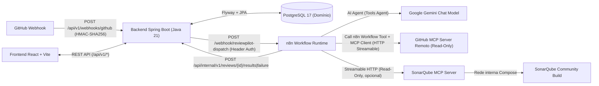

# ReviewPilot — Arquitetura do Sistema

> **Última verificação de versões e compatibilidade:** 14/11/2026

## 1. Visão Geral

O **ReviewPilot** é um monorepo com serviços isolados orquestrados localmente via Docker Compose. O agente de revisão de código (`Review Agent`) é construído e executado **integralmente dentro de um workflow do n8n** utilizando o nó `AI Agent` (*Tools Agent*), o subnó `Google Gemini Chat Model` e ferramentas Model Context Protocol (MCP) em modo somente leitura. Não existe serviço de agente separado em Python/FastAPI.

## 2. Componentes e Versões Fixadas

| Componente | Imagem / Tecnologia | Versão Fixada | Profile Compose | Porta Local (Host) |
|---|---|---|---|---|
| Banco de Dados de Domínio | `postgres:17.2-alpine` | `17.2-alpine` | padrão | `127.0.0.1:5432` |
| Runtime do Agente e Workflows | `docker.n8n.io/n8nio/n8n:2.47.4` | `2.47.4` | padrão | `127.0.0.1:5678` |
| Backend API e Domínio | Java 21 + Spring Boot 3.5.11 + Maven | `0.1.0-local` | `backend` / `full` | `127.0.0.1:8080` |
| Frontend Dashboard | React + TypeScript + Vite (Node `22.19.0`) | `0.1.0-local` | `frontend` / `full` | `127.0.0.1:5173` |
| SonarQube Community Build | `sonarqube:25.1.0.102122-community` | `25.1.0.102122-community` | `quality` | `127.0.0.1:9000` |
| SonarQube MCP Server | `sonarsource/sonarqube-mcp:1.21.0.2975` | `1.21.0.2975` | `quality` | Somente rede interna (`8080`) |

## 3. Isolamento de Dados

- **PostgreSQL (`reviewpilot_postgres_data`):** única fonte de verdade para tabelas de negócio (`repositories`, `pull_requests`, `review_executions`, `findings`, `webhook_deliveries`, `review_actions`, `tool_executions`). Apenas o backend Spring Boot possui acesso a este banco.
- **Armazenamento interno do n8n (`reviewpilot_n8n_data`):** volume persistente exclusivo do n8n (`/home/node/.n8n`), onde ficam workflows e credenciais criptografadas por `N8N_ENCRYPTION_KEY`. Não compartilha banco nem tabelas com o domínio do ReviewPilot.

## 4. Integração com Google Gemini Chat Model no n8n

- **Subnó utilizado:** `@n8n/n8n-nodes-langchain.lmChatGoogleGemini` (`typeVersion: 1`), conectado via saída `ai_languageModel` ao nó `AI Agent` (`@n8n/n8n-nodes-langchain.agent`).
- **Credencial criptografada no n8n:** tipo `googlePalmApi` (exibida na UI como `Google Gemini(PaLM) Api`), nomeada `ReviewPilot Google Gemini API`. A chave da API jamais é armazenada em `.env`, código Java ou JSON exportado.
- **Seleção de modelo e parâmetros validados (verificado em `2026-11-14`):**
  - **Modelo estável padrão:** `models/gemini-3.5-flash-lite` (validado em chamada real no n8n com baixa latência ~1s, suporte nativo a *Function Calling* / *Tool Calling* e saídas estruturadas, sem sofrer os picos de erro `503 Service Unavailable` observados no `models/gemini-3.8-flash`).
  - **Alternativas suportadas:** `models/gemini-3.8-flash` ou `models/gemini-3.8-pro` (selecionáveis diretamente no parâmetro `modelName` do nó no n8n sem alteração no código da aplicação).
  - **Temperatura (`options.temperature`):** `0.1` (baixa variabilidade para priorizar precisão técnica e reprodutibilidade na análise de código).
  - **Limite de tokens de saída (`options.maxOutputTokens`):** `4096` (dimensionado para suportar o JSON completo de `contracts/review-result.schema.json` com até 50 findings).
  - **Timeouts operacionais:** `executionTimeout: 180` segundos no workflow principal (`ReviewPilot - Analyze Pull Request`) e `60` segundos nos workflows de diagnóstico.
- **Compatibilidade entre Function Calling e Structured Output Parser:**
  - Conforme documentado nas seções 9.6 e 10.2 do guia de implementação, em determinadas combinações da Gemini API / LangChain o envio simultâneo de ferramentas (`tools`) e `response_schema` estrito (`Structured Output Parser`) na mesma requisição pode resultar em erro `400 Bad Request`. Caso essa restrição se manifeste na Fase 7 com as ferramentas MCP conectadas, o contrato `contracts/review-result.schema.json` é preservado exigindo saída JSON estrita no `System Message`, normalização determinística no workflow (`Validate and Normalize Result`) e validação rigorosa no backend Spring Boot.

## 5. Compatibilidade de Transporte MCP no n8n (`2.47.4`)

- **Inspeção prática na imagem `docker.n8n.io/n8nio/n8n:2.47.4` (verificado em `2026-11-14`):**
  - O nó interno de Registro MCP (`@n8n/n8n-nodes-langchain.mcpRegistryClientTool` `v1.1`) exige credencial `mcpOAuth2Api` e não permite configurar Fine-Grained Personal Access Token com os cabeçalhos obrigatórios `X-MCP-Readonly: true` e `X-MCP-Toolsets: repos,pull_requests`.
  - O nó regular **`MCP Client`** (`@n8n/n8n-nodes-langchain.mcpClient` `v1.1`) oferece nativamente `serverTransport: "httpStreamable"` (`HTTP Streamable`) e `authentication: "multipleHeadersAuth"` (`httpMultipleHeadersAuth`).
- **GitHub MCP Server (`https://api.githubcopilot.com/mcp/`):**
  - Opera via **HTTP Streamable** (`httpStreamable`) com credencial `Multiple Headers Auth` (`ReviewPilot GitHub MCP Read-Only`) contendo `Authorization: Bearer <token>`, `X-MCP-Readonly: true` e `X-MCP-Toolsets: repos,pull_requests`.
  - Exposto ao `AI Agent` por **3 subworkflows de leitura** (`infra/n8n/workflows/tools/`) conectados via **`Call n8n Workflow Tool`** (`@n8n/n8n-nodes-langchain.toolWorkflow` `v2.2`):
    1. `github_pr_read_tool` → `pull_request_read` (allowlist de métodos: `get`, `get_files`, `get_diff`, `get_commits`).
    2. `github_get_file_contents_tool` → `get_file_contents` (leitura de arquivo/diretório por SHA/ref com bloqueio de `..`).
    3. `github_list_commits_tool` → `list_commits` (listagem de commits por branch/SHA).
- **SonarQube MCP Server (`http://sonarqube-mcp:8080/mcp`):**
  - Opera na rede interna `reviewpilot-net` via **Streamable HTTP** (`SONARQUBE_TRANSPORT=http`, `SONARQUBE_READ_ONLY=true`) e não suporta o transporte SSE legado.

## 6. Limitações do SonarQube Community Build

A edição Community Build analisa a branch principal e não oferece análise nativa de Pull Request. Por isso:
- O `Review Agent` realiza a análise primária do diff diretamente via GitHub MCP + Gemini.
- Alertas retornados pelo SonarQube MCP são tratados como contexto complementar (`SONARQUBE` ou `CORRELATED`), nunca como prova de ausência de defeitos ou de introdução exclusiva pelo Pull Request.
- Quando o profile `quality` estiver desligado, o agente continua a revisão normalmente e registra a ausência do SonarQube em `limitations[]`.
